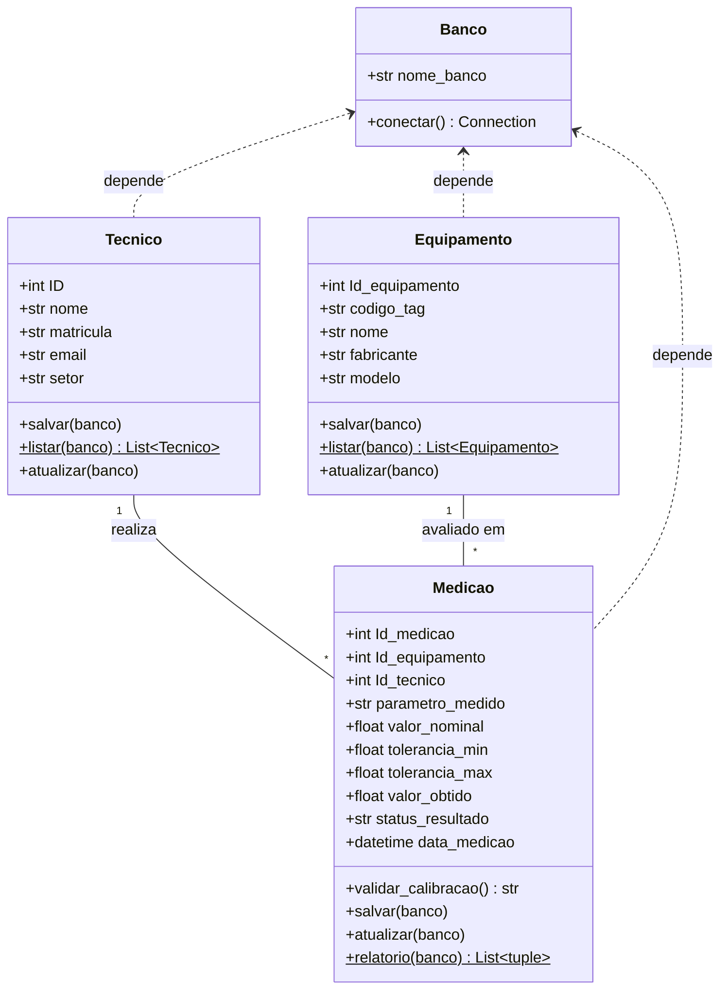

# Documentação Técnica do MVP (Parte 1)

**Unidade Curricular:** Projeto Aplicado I  
**Empresa Parceira:** Schulz S.A.  
**Docentes:** Prof. MSc. Hugo Menezes Barra e Prof. Rodrigo Losina  
**Grupo 25:** Cristiane Nicolei | Matheus Martins | Priscilla Roncatto  
**Entrega:** AV 03: Construção do MVP (Parte 1)  
**Repositório:** https://github.com/RoncattoP/Projeto-para-emissao-de-certificado  
**Data:** Outubro de 2026  

## 1. Padrões de Programação Orientada a Objetos (POO)

O sistema foi desenvolvido em Python, seguindo a Programação Orientada a Objetos. Cada classe reúne os dados e o comportamento do que ela representa, os arquivos têm funções separadas e o código pode ser reaproveitado. Os dados ficam em um banco relacional SQLite, acessado pelo módulo sqlite3.

Arquivos desta entrega:

| Arquivo | Função |
|---|---|
| 03_banco.sql | Script DDL com as tabelas tecnico, equipamento e medicao (PK, FK e restrições) |
| 04_classes.py | Classes de domínio, validação de tolerância e métodos de acesso ao banco |
| 05_main.py | Script de demonstração: INSERT, SELECT, UPDATE, JOIN e teste de erro |
| 06_mvp_parte1.md | Esta documentação técnica, em Markdown |

### 1.1 Classes de entidade (domínio)

Foram criadas três classes: Tecnico, Equipamento e Medicao. O construtor (__init__) de cada uma recebe os atributos que correspondem aos campos do dicionário de dados. Alguns nomes em Python diferem dos nomes das colunas do banco. Por exemplo, self.nome guarda a coluna nome_tecnico no Tecnico e a coluna nome_equipamento no Equipamento. A tabela abaixo mostra todas as equivalências.

| Classe Python | Atributo (self) | Tabela SQLite | Coluna no banco |
|---|---|---|---|
| Tecnico | self.ID | tecnico | id_tecnico |
| Tecnico | self.nome | tecnico | nome_tecnico |
| Tecnico | self.matricula | tecnico | matricula |
| Tecnico | self.email | tecnico | email |
| Tecnico | self.setor | tecnico | setor |
| Equipamento | self.Id_equipamento | equipamento | id_equipamento |
| Equipamento | self.codigo_tag | equipamento | codigo_tag |
| Equipamento | self.nome | equipamento | nome_equipamento |
| Equipamento | self.fabricante | equipamento | fabricante |
| Equipamento | self.modelo | equipamento | modelo |
| Medicao | self.Id_medicao | medicao | id_medicao |
| Medicao | self.Id_equipamento | medicao | id_equipamento (FK) |
| Medicao | self.Id_tecnico | medicao | id_tecnico (FK) |
| Medicao | self.parametro_medido | medicao | parametro_medido |
| Medicao | self.valor_nominal | medicao | valor_nominal |
| Medicao | self.tolerancia_min | medicao | tolerancia_min |
| Medicao | self.tolerancia_max | medicao | tolerancia_max |
| Medicao | self.valor_obtido | medicao | valor_obtido |
| Medicao | self.status_resultado | medicao | status_resultado |
| Medicao | self.data_medicao | medicao | data_medicao |

### 1.2 Abstração do banco de dados

A classe Banco cuida do nome do arquivo do banco e da conexão (sqlite3.connect). Quando conecta, ela ativa PRAGMA foreign_keys = ON, para o SQLite respeitar as chaves estrangeiras. As outras classes só recebem um objeto Banco e pedem a conexão a ele, dessa forma não há necessidade de repetir essa configuração.

### 1.3 Regra de negócio dentro da classe

A regra que decide se uma medição é APROVADO ou REPROVADO fica dentro da classe Medicao, no método validar_calibracao(), e não solta no arquivo principal. Ele compara o valor obtido com os limites: tolerancia_min <= valor_obtido <= tolerancia_max. Já o método salvar() chama o validar_calibracao() antes de gravar, então o status gravado sempre vem dessa regra.

### 1.4 Métodos estáticos (@staticmethod)

Alguns métodos devolvem vários registros e não dependem de uma única instância, por isso são métodos estáticos: Tecnico.listar() e Equipamento.listar() (SELECT simples) e Medicao.relatorio() (SELECT com JOIN).

### 1.5 Separação de responsabilidades

O 04_classes.py guarda as classes e o acesso ao banco. O 05_main.py só usa essas classes para mostrar o sistema funcionando: cria os objetos, chama os métodos e imprime o relatório. Nenhuma regra de negócio fica no arquivo principal.

### 1.6 Operações CRUD implementadas

| Classe | Create (INSERT) | Read (SELECT) | Update | Delete |
|---|---|---|---|---|
| Tecnico | salvar() | listar() | atualizar() | não implementado |
| Equipamento | salvar() | listar() | atualizar() | não implementado |
| Medicao | salvar() | relatorio() (JOIN) | atualizar() | não implementado |

O roteiro detalha INSERT, SELECT e UPDATE, e os três estão implementados nas três classes. A decisão sobre o DELETE está explicada na seção 3.5.

## 2. Diagramação Textual / UML das Classes

Abaixo está a estrutura das classes do arquivo 04_classes.py. A marcação [estatico] indica os métodos estáticos e (FK) indica as chaves estrangeiras.

```
        +---------------------------+
        |           Banco           |
        +---------------------------+
        | nome_banco : str          |
        +---------------------------+
        | conectar() : Connection   |
        +---------------------------+
                    ^
                    |  todas as classes dependem do Banco
                    |  (conectar) para acessar o SQLite

+---------------------------+  +---------------------------+  +------------------------------+
|          Tecnico          |  |        Equipamento        |  |           Medicao            |
+---------------------------+  +---------------------------+  +------------------------------+
| ID : int                  |  | Id_equipamento : int      |  | Id_medicao : int             |
| nome : str                |  | codigo_tag : str          |  | Id_equipamento : int (FK)    |
| matricula : str           |  | nome : str                |  | Id_tecnico : int (FK)        |
| email : str               |  | fabricante : str          |  | parametro_medido : str       |
| setor : str               |  | modelo : str              |  | valor_nominal : float        |
+---------------------------+  +---------------------------+  | tolerancia_min : float       |
| salvar(banco)             |  | salvar(banco)             |  | tolerancia_max : float       |
| listar(banco) [estatico]  |  | listar(banco) [estatico]  |  | valor_obtido : float         |
| atualizar(banco)          |  | atualizar(banco)          |  | status_resultado : str       |
+---------------------------+  +---------------------------+  | data_medicao : datetime      |
                                                              +------------------------------+
                                                              | validar_calibracao()         |
                                                              | salvar(banco)                |
                                                              | atualizar(banco)             |
                                                              | relatorio(banco) [estatico]  |
                                                              +------------------------------+

Relacionamentos:
  Tecnico (1) ------< (N) Medicao   : um tecnico realiza varias medicoes
  Equipamento (1) --< (N) Medicao   : um equipamento e avaliado em varias medicoes
```



## 3. Tratamento de Erros SQL

### 3.1 Blocos try...except...finally

Todos os métodos que acessam o banco (salvar, listar, atualizar e relatorio) usam try...except...finally. Quando um comando falha, o código captura o erro sqlite3.Error e mostra uma mensagem no terminal, como "Erro ao salvar técnico" ou "Erro ao gerar relatório". O programa continua funcionando em vez de parar.

```
def salvar(self, banco):
    conexao = banco.conectar()
    try:
        cursor = conexao.cursor()
        cursor.execute("INSERT INTO ...", (...))
        conexao.commit()
    except sqlite3.Error as erro:
        print(f"Erro ao salvar tecnico: {erro}")
    finally:
        conexao.close()
```

### 3.2 Gestão de recursos

O bloco finally executa conexao.close() em todos os métodos que se comunicam com o banco. Assim a conexão sempre fecha, com erro ou sem erro, e o arquivo do banco não fica preso.

### 3.3 Testes de violação de integridade (UNIQUE e FOREIGN KEY)

Foram realizados os testes abaixo durante o desenvolvimento, no próprio 04_classes.py. Nos três casos o banco recusa o registro, o programa não quebra e o ID gerado fica None. A matrícula repetida também aparece no 05_main.py (seção 4).

**Figura 1: matrícula duplicada. O banco responde UNIQUE constraint failed: tecnico.matricula.**

```
Erro ao salvar técnico: UNIQUE constraint failed: tecnico.matricula
ID gerado: None
```

**Figura 2: código/TAG de equipamento duplicado. O banco responde UNIQUE constraint failed: equipamento.codigo_tag.**

```
Erro ao salvar técnico: UNIQUE constraint failed: tecnico.matricula
ID gerado: None
Erro ao salvar equipamento: UNIQUE constraint failed: equipamento.codigo_tag
ID equipamento: None
```

**Figura 3: medição com técnico e equipamento inexistentes (ids 99). O banco responde FOREIGN KEY constraint failed.**

```
Erro ao salvar med: FOREIGN KEY constraint failed
ID medição: None
```

### 3.4 Proteção contra SQL Injection

Os comandos que recebem dados (INSERT e UPDATE) usam consultas parametrizadas: o texto do comando e os valores são enviados separadamente, com um ? no lugar de cada valor.

```
cursor.execute(
    "INSERT INTO tecnico (nome_tecnico, matricula, email, setor) "
    "VALUES (?, ?, ?, ?)",
    (self.nome, self.matricula, self.email, self.setor),
)
```

Isso foi implementado porque, se o comando fosse montado juntando texto, alguém poderia digitar um pedaço de comando SQL no lugar de um nome, e o banco o executaria. Esse ataque se chama SQL Injection. Com o ?, o SQLite trata o valor sempre como dado, nunca como comando. Essa proteção foi aplicada nos métodos salvar() e atualizar() das três classes. Os métodos listar() e relatorio() não recebem dados de fora. As restrições do banco também ajudam: PRAGMA foreign_keys = ON, UNIQUE, NOT NULL e CHECK.

### 3.5 Decisão de projeto: DELETE não implementado

O DELETE não foi implementado nesta etapa, de forma intencional. O banco usa ON DELETE RESTRICT, que impede excluir técnicos e equipamentos que já têm medições. Assim, o histórico e a rastreabilidade dos certificados de calibração ficam preservados.

## 4. Validação do Fluxo Funcional do MVP

O fluxo foi validado no script principal 05_main.py, que executa, em sequência:

- Recria o banco (DDL): lê e executa o 03_banco.sql em um banco novo (demo_calibracao.db), para a demonstração dar sempre o mesmo resultado.
- INSERT: cria e grava dois técnicos (Ava e Jan) e um equipamento (Paquímetro PAQ-001).
- Regra de negócio: grava três medições, com valores 10.02 (APROVADO), 10.5 e 9.5 (REPROVADO), comparando com os limites 9.9 e 10.1.
- SELECT: lista os técnicos e os equipamentos cadastrados com Tecnico.listar() e Equipamento.listar().
- UPDATE: muda o setor do técnico Jan para Qualidade, o nome do equipamento para Paquímetro digital e corrige o valor da medição 2 para 10.05, que passa a ser APROVADO porque o status é recalculado.
- JOIN: Medicao.relatorio() cruza medicao, equipamento e tecnico (INNER JOIN), e o script imprime o relatório de calibração no terminal.
- Erro SQL: tenta gravar uma matrícula repetida e mostra que o banco recusa.

Saída real da execução do 05_main.py:

```
======================================================================
 MVP PARTE 1 - SISTEMA DE CALIBRAÇÃO | SCHULZ S.A.
======================================================================

[1] Cadastrando técnicos e equipamento...
    Técnico gravado: Ava (ID 1)
    Técnico gravado: Jan (ID 2)
    Equipamento gravado: PAQ-001 - Paquímetro (ID 1)

[2] Registrando medições (o status é calculado pela tolerância)...
    Medição 1: valor 10.02 -> APROVADO
    Medição 2: valor 10.5  -> REPROVADO
    Medição 3: valor 9.5   -> REPROVADO

[3] Técnicos cadastrados (SELECT):
    ID 1 | Ava | matrícula 001 | Metrologia
    ID 2 | Jan | matrícula 002 | Metrologia

    Equipamentos cadastrados (SELECT):
    ID 1 | PAQ-001 | Paquímetro | Mitutoyo

[4] Atualizando registros (UPDATE):
    Técnico Jan: o setor agora é Qualidade
    Equipamento PAQ-001: o nome agora é Paquímetro digital
    Medição 2: valor corrigido para 10.05 -> APROVADO

[5] RELATÓRIO DE CALIBRAÇÃO (JOIN entre medicao, equipamento e tecnico)
======================================================================
 Medição nº 1  |  2026-10-31 20:05:47
 Equipamento : PAQ-001 - Paquímetro digital
 Técnico     : Ava
 Parâmetro   : Comprimento  (nominal 10.0)
 Limites     : 9.9 a 10.1
 Obtido      : 10.02
 RESULTADO   : APROVADO
----------------------------------------------------------------------
 Medição nº 2  |  2026-10-31 20:05:47
 Equipamento : PAQ-001 - Paquímetro digital
 Técnico     : Jan
 Parâmetro   : Comprimento  (nominal 10.0)
 Limites     : 9.9 a 10.1
 Obtido      : 10.05
 RESULTADO   : APROVADO
----------------------------------------------------------------------
 Medição nº 3  |  2026-10-31 20:05:47
 Equipamento : PAQ-001 - Paquímetro digital
 Técnico     : Ava
 Parâmetro   : Comprimento  (nominal 10.0)
 Limites     : 9.9 a 10.1
 Obtido      : 9.5
 RESULTADO   : REPROVADO
----------------------------------------------------------------------

[6] Teste de erro SQL (matrícula repetida):
Erro ao salvar técnico: UNIQUE constraint failed: tecnico.matricula
    ID gerado: None  (None = o banco recusou o registro)

Demonstração concluída.
```

### 4.1 Evidências dos testes de desenvolvimento

Estas evidências vêm de testes realizados no 04_classes.py durante o desenvolvimento de cada método.

Validação da regra de tolerância (limites 9.9 a 10.1, valor nominal 10): 10.02 e 9.9 são aprovados, 10.5 e 9.5 são reprovados. Esta é a saída do método Medicao.validar_calibracao() para os quatro valores:

```
10.02 -> APROVADO
10.5 -> REPROVADO
9.9 -> APROVADO
9.5 -> REPROVADO
```

**Figura 4: SELECT. O Tecnico.listar() recupera o técnico gravado no banco.**

```
1 Ana 001
```

**Figura 5: UPDATE. Depois do atualizar(), a nova leitura mostra o setor alterado.**

```
1 Ana 001            (antes do UPDATE)
1 Ana Qualidade      (depois do UPDATE)
```

## 5. Conclusão

O MVP (Parte 1) entrega as classes Tecnico, Equipamento e Medicao, a classe Banco para a conexão com o SQLite, a validação de tolerância e uma demonstração completa no 05_main.py, com INSERT, SELECT, UPDATE e uma consulta com JOIN. Os erros do banco são tratados sem parar o programa, e as consultas parametrizadas protegem contra SQL Injection.

As três classes implementam INSERT, SELECT e UPDATE. O DELETE ficou de fora de forma intencional, conforme explicado na seção 3.5. As próximas etapas evoluem a partir dessa base.

Código-fonte: https://github.com/RoncattoP/Projeto-para-emissao-de-certificado
